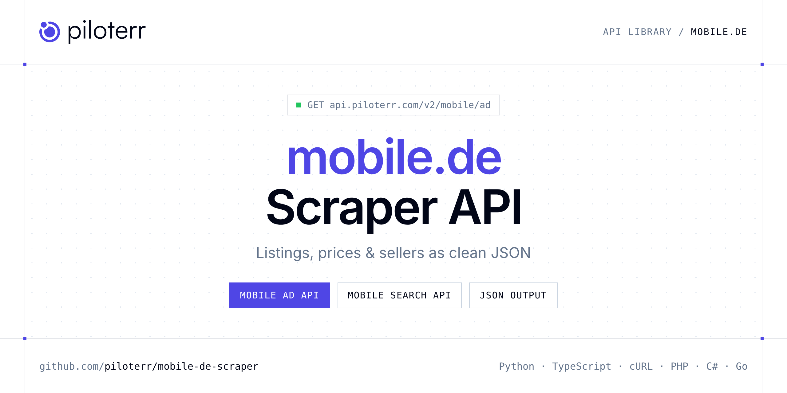

<p align="center">
  <a href="https://www.piloterr.com"></a>
</p>

# mobile.de Scraper API

[](https://discord.gg/CFj3ph8aHU) [](https://app.piloterr.com) [](https://app.piloterr.com/openapi) [](LICENSE)

The **Piloterr mobile.de Scraper API** lets you extract public data from mobile.de as **clean, structured JSON** — no proxies, headless browsers or HTML parsing to maintain. Endpoints available in production:

- **Mobile Ad API** — Mobile Ad API.
- **Mobile Search API** — Mobile Search API.

Use it for listing monitoring, price benchmarks, stock sourcing or market analytics on second-hand and vehicle marketplaces.

| Endpoint | Path | Credits | What you get |
|---|---|---|---|
| [Mobile Ad API](#mobile-ad-api) | `/v2/mobile/ad` | 3 | Mobile Ad API. Fetch full car listing data from a mobile.de ad URL or numeric id. Returns pricing, specs, images and features via webunlocker. |
| [Mobile Search API](#mobile-search-api) | `/v2/mobile/search` | 3 | Mobile Search API. Same mobile.de inventory for every locale. `locale` sets the language label and ad links, not which cars are returned. (3 credits) |

## Table of contents

- [How it works](#how-it-works)
- [Mobile Ad API](#mobile-ad-api)
- [Mobile Search API](#mobile-search-api)
- [Code examples in other languages](#code-examples-in-other-languages)
- [Practical use cases](#practical-use-cases)
- [Why Piloterr?](#why-piloterr)
- [FAQ](#faq)
- [Official SDKs](#official-sdks)
- [Related scrapers](#related-scrapers)
- [Support](#support)

## How it works

1. **Create a free Piloterr account** and copy your API key from the [dashboard](https://app.piloterr.com).
2. **Send a `GET` (or `POST`) request** to `https://api.piloterr.com/v2/...` with the header `x-api-key: YOUR_API_KEY`.
3. **Receive structured JSON** — Piloterr handles rendering, proxies, retries and parsing.

```bash
export PILOTERR_API_KEY="your-api-key"
pip install requests        # Python
# TypeScript: Node.js 18+ (native fetch), run with `npx tsx file.ts`
```

> Every endpoint accepts both `GET` (query string) and `POST` (JSON body with the same fields).

## Mobile Ad API

Mobile Ad API. Fetch full car listing data from a mobile.de ad URL or numeric id. Returns pricing, specs, images and features via webunlocker.

`GET | POST https://api.piloterr.com/v2/mobile/ad` · **3 credits per request** · [Full reference](https://app.piloterr.com/openapi)

### Request parameters

| Parameter | Type | Required | Description |
|---|---|---|---|
| `query` | string | ✅ | Mobile ad URL or numeric ad id. |
| `locale` | string | — | Language for this ad. The same numeric id stays reachable for fr, es, de, and en. |
| `return_page_source` | boolean | — | When `true`, return the raw HTML page source as `{"result": "..."}` instead of structured JSON. Defaults to `false`. |

### Python example

```python
import json
import os
import requests

response = requests.get(
    "https://api.piloterr.com/v2/mobile/ad",
    headers={"x-api-key": os.environ["PILOTERR_API_KEY"]},
    params={
        "query": "455111824",
    },
    timeout=120,
)
response.raise_for_status()
data = response.json()

print(json.dumps(data, indent=2, ensure_ascii=False)[:2000])
```

### TypeScript example

```typescript
type MobileAd = {
  url?: string;
  make?: string;
  ad_id?: string;
  model?: string;
  power?: string;
  price?: number;
  title?: string;
  locale?: string;
  mileage?: string;
  category?: string;
  currency?: string;
  features?: string[];
  fuel_type?: string;
  image_url?: string;
  transmission?: string;
  first_registration?: string;
};

const params = new URLSearchParams({
  "query": "455111824",
});

const response = await fetch(`https://api.piloterr.com/v2/mobile/ad?${params}`, {
  headers: { "x-api-key": process.env.PILOTERR_API_KEY! },
});
if (!response.ok) throw new Error(`Piloterr error ${response.status}: ${await response.text()}`);

const data = (await response.json()) as MobileAd;

console.log(JSON.stringify(data, null, 2).slice(0, 2000));
```

<details>
<summary><b>POST variant</b></summary>

```http
POST https://api.piloterr.com/v2/mobile/ad
x-api-key: YOUR_API_KEY
Content-Type: application/json

{"query": "455111824"}
```
</details>

### Output example

Example response from the API reference, abridged — real values depend on the page you scrape.

```json
{
  "url": "https://www.mobile.de/fr/voiture/d%C3%A9tails.html?id=455111824",
  "make": "Porsche",
  "ad_id": "455111824",
  "model": "Taycan",
  "power": "390 kW (530 ch)",
  "price": 80990,
  "title": "Porsche Taycan 4S",
  "locale": "fr",
  "mileage": "22.000 km",
  "category": "Berline",
  "currency": "EUR",
  "features": [
    "ABS",
    "Airbags"
  ],
  "fuel_type": "Électrique",
  "image_url": "https://img.classistatic.de/api/v1/mo-prod/images/jpg/normal/95/taycan_main.jpg",
  "transmission": "Automatique",
  "first_registration": "05/2021"
}
```

### Response fields

| Field | Type | Description |
|---|---|---|
| `url` | string |  |
| `make` | string |  |
| `ad_id` | string |  |
| `model` | string |  |
| `power` | string |  |
| `price` | integer |  |
| `title` | string |  |
| `locale` | string |  |
| `mileage` | string |  |
| `category` | string |  |
| `currency` | string |  |
| `features` | string[] |  |
| `fuel_type` | string |  |
| `image_url` | string |  |
| `transmission` | string |  |
| `first_registration` | string |  |

## Mobile Search API

Mobile Search API. Same mobile.de inventory for every locale. `locale` sets the language label and ad links, not which cars are returned. (3 credits)

`GET | POST https://api.piloterr.com/v2/mobile/search` · **3 credits per request** · [Full reference](https://app.piloterr.com/openapi)

### Request parameters

| Parameter | Type | Required | Description |
|---|---|---|---|
| `query` | string | ✅ | Search URL or make/model code (`ms=`). |
| `locale` | string | — | Locale label for the results. The cars themselves stay the same for de, fr, and en. |
| `page` | number | — | Page number, starting at 1. Same effect as page or pageNumber in the Mobile.de URL. |
| `return_page_source` | boolean | — | When `true`, return the raw HTML page source as `{"result": "..."}` instead of structured JSON. Defaults to `false`. |

### Python example

```python
import json
import os
import requests

response = requests.get(
    "https://api.piloterr.com/v2/mobile/search",
    headers={"x-api-key": os.environ["PILOTERR_API_KEY"]},
    params={
        "query": "20100",
    },
    timeout=120,
)
response.raise_for_status()
data = response.json()

print(json.dumps(data, indent=2, ensure_ascii=False)[:2000])
```

### TypeScript example

```typescript
type MobileSearch = {
  results?: {
    url?: string;
    make?: string;
    ad_id?: string;
    model?: string;
    power?: string;
    price?: number;
    title?: string;
    locale?: string;
    mileage?: string;
    currency?: string;
    location?: string;
    fuel_type?: string;
    image_url?: string;
    price_rating?: string;
    transmission?: string;
    first_registration?: string;
    price_rating_label?: string;
  }[];
  pagination?: {
    next?: unknown;
    page?: number;
    per_page?: number;
    total_pages?: unknown;
    total_results?: unknown;
  };
};

const params = new URLSearchParams({
  "query": "20100",
});

const response = await fetch(`https://api.piloterr.com/v2/mobile/search?${params}`, {
  headers: { "x-api-key": process.env.PILOTERR_API_KEY! },
});
if (!response.ok) throw new Error(`Piloterr error ${response.status}: ${await response.text()}`);

const data = (await response.json()) as MobileSearch;

console.log(JSON.stringify(data, null, 2).slice(0, 2000));
```

<details>
<summary><b>POST variant</b></summary>

```http
POST https://api.piloterr.com/v2/mobile/search
x-api-key: YOUR_API_KEY
Content-Type: application/json

{"query": "20100"}
```
</details>

### Output example

Example response from the API reference, abridged — real values depend on the page you scrape.

```json
{
  "results": [
    {
      "url": "https://www.mobile.de/fr/voiture/d%C3%A9tails.html?id=455007337&s=Car&vc=Car",
      "make": "Porsche",
      "ad_id": "455007337",
      "model": "Cayman",
      "power": "265 kW (360 ch)",
      "price": 54990,
      "title": "Porsche Cayman S PDK",
      "locale": "fr",
      "mileage": "22.500 km",
      "currency": "EUR",
      "location": "München",
      "fuel_type": "Essence",
      "image_url": "https://img.classistatic.de/api/v1/mo-prod/images/jpg/normal/95/mt_mte247ax-wr.jpg",
      "price_rating": "GOOD_PRICE",
      "transmission": "Automatique",
      "first_registration": "03/2021",
      "price_rating_label": "Bon prix"
    }
  ],
  "pagination": {
    "next": null,
    "page": 1,
    "per_page": 50,
    "total_pages": null,
    "total_results": null
  }
}
```

### Response fields

| Field | Type | Description |
|---|---|---|
| `results[]` | object[] |  |
| `results[].url` | string |  |
| `results[].make` | string |  |
| `results[].ad_id` | string |  |
| `results[].model` | string |  |
| `results[].power` | string |  |
| `results[].price` | integer |  |
| `results[].title` | string |  |
| `results[].locale` | string |  |
| `results[].mileage` | string |  |
| `results[].currency` | string |  |
| `results[].location` | string |  |
| `results[].fuel_type` | string |  |
| `results[].image_url` | string |  |
| `results[].price_rating` | string |  |
| `results[].transmission` | string |  |
| `results[].first_registration` | string |  |
| `results[].price_rating_label` | string |  |
| `pagination` | object |  |
| `pagination.next` | object |  |
| `pagination.page` | integer |  |
| `pagination.per_page` | integer |  |
| `pagination.total_pages` | object |  |
| `pagination.total_results` | object |  |

## Code examples in other languages

Ready-to-run examples live in the [`examples/`](examples) folder. Each one reads your key from the `PILOTERR_API_KEY` environment variable.

| Language | Mobile Ad | Mobile Search |
|---|---|---|
| cURL (Bash) | [`ad`](examples/curl/ad.sh) | [`search`](examples/curl/search.sh) |
| PHP | [`ad`](examples/php/ad.php) | [`search`](examples/php/search.php) |
| C# | [`ad`](examples/csharp/Ad.cs) | [`search`](examples/csharp/Search.cs) |
| Go | [`ad`](examples/go/ad.go) | [`search`](examples/go/search.go) |
| Java | [`ad`](examples/java/AdExample.java) | [`search`](examples/java/SearchExample.java) |
| Ruby | [`ad`](examples/ruby/ad.rb) | [`search`](examples/ruby/search.rb) |
| Node.js | [`ad`](examples/nodejs/ad.mjs) | [`search`](examples/nodejs/search.mjs) |

## Practical use cases

- **Listing monitoring** — Get alerted when new ads matching your criteria are published.
- **Price benchmarks** — Compute market prices per model, category or location.
- **Sourcing** — Find stock, vehicles, parts or equipment faster than manual browsing.
- **Market analytics** — Measure supply, turnover and pricing trends over time.
- **Data products** — Feed valuation models and dashboards with structured listings.

## Why Piloterr?

- **No infrastructure** — no proxies, headless browsers or CAPTCHA solving to run yourself.
- **Structured JSON** — stable, documented fields instead of brittle HTML selectors.
- **Pay per request** — transparent credit cost per endpoint, failed requests are retried for you.
- **One API key, hundreds of sources** — mobile.de plus many other e-commerce, search and company data endpoints in the [Piloterr library](https://www.piloterr.com/library).
- **Any language** — plain HTTPS + JSON, with examples for Python, TypeScript, cURL, PHP, C#, Go, Java, Ruby and Node.js.

## FAQ

### Is it legal to scrape mobile.de?

Collecting publicly available data is generally allowed in many jurisdictions, but rules depend on your country, the data you collect and how you use it. Avoid personal data unless you have a lawful basis, respect the website's terms where they apply, and get legal advice for your specific use case. This is not legal advice.

### Do I need proxies or a headless browser?

No. Piloterr handles rendering, proxy rotation and retries on its side. You only send an HTTPS request with your `x-api-key` header and receive JSON.

### How much does a request cost?

Credits per call: `/v2/mobile/ad` **3**, `/v2/mobile/search` **3**. See the [Piloterr website](https://www.piloterr.com) for plans.

### What data does the mobile.de API return?

Each endpoint returns structured JSON: **Mobile Ad** — `url`, `make`, `ad_id`, `model`, `power`, `price`; **Mobile Search** — `results[]`, `results[].url`, `results[].make`, `results[].ad_id`, `results[].model`, `results[].power`.

### How do I paginate mobile.de results?

Use the `page` parameter and keep requesting while the response indicates more results.

### Can I target a specific country or language?

Yes, use `locale` — see the parameter tables above for accepted values.

### Can I get the raw HTML instead of JSON?

Yes. Set `return_page_source=true` and the response becomes `{"result": "..."}` with the page source.

### Which languages are supported?

Any language that can make an HTTP request. This README shows Python and TypeScript; the [`examples/`](examples) folder contains cURL, PHP, C#, Go, Java, Ruby and Node.js.

## Official SDKs

Use Piloterr from your own language with a typed client:

| SDK | Package | Install |
| --- | --- | --- |
| Node.js | [`@piloterr/sdk`](https://www.npmjs.com/package/@piloterr/sdk) | `npm install @piloterr/sdk` |
| Python | [`piloterr`](https://pypi.org/project/piloterr/) | `pip install piloterr` |
| Go | [`piloterr-go`](https://pkg.go.dev/github.com/piloterr/piloterr-go) | `go get github.com/piloterr/piloterr-go` |
| .NET | [`Piloterr`](https://www.nuget.org/packages/Piloterr) | `dotnet add package Piloterr` |
| Ruby | [`piloterr`](https://rubygems.org/gems/piloterr) | `gem install piloterr` |
| PHP | [`piloterr/sdk`](https://packagist.org/packages/piloterr/sdk) | `composer require piloterr/sdk` |
| Java | [`piloterr-java`](https://github.com/piloterr/piloterr-java) | build from source, see its README |
| CLI | [`@piloterr/cli`](https://www.npmjs.com/package/@piloterr/cli) | `npm install -g @piloterr/cli` |
| MCP server | [`@piloterr/mcp`](https://www.npmjs.com/package/@piloterr/mcp) | `npx -y @piloterr/mcp` |

## Related scrapers

- [AutoScout24 Scraper API](https://github.com/piloterr/autoscout24-scraper)
- [Autotrader Scraper API](https://github.com/piloterr/autotrader-scraper)
- [Copart Scraper API](https://github.com/piloterr/copart-scraper)
- [Kijiji Scraper API](https://github.com/piloterr/kijiji-scraper)
- [Leboncoin Scraper API](https://github.com/piloterr/leboncoin-scraper)
- [Mascus Scraper API](https://github.com/piloterr/mascus-scraper)
- [All Piloterr scrapers on GitHub](https://github.com/piloterr)

## Support

- 💬 Join the [Piloterr Discord](https://discord.gg/CFj3ph8aHU) to ask questions and share what you build.
- 📚 Browse the [API reference (OpenAPI)](https://app.piloterr.com/openapi) and the [Piloterr library](https://www.piloterr.com/library).
- 🔑 [Get your API key](https://app.piloterr.com).

---

<p align="center">
  <a href="https://www.piloterr.com">
    <picture>
      <source media="(prefers-color-scheme: dark)" srcset="images/logo-dark.svg">
      
    </picture>
  </a>
  <br>
  <sub>Built by <a href="https://www.piloterr.com">Piloterr</a> — web scraping APIs for e-commerce, search, real estate and more, one API key.</sub>
</p>

<sub>mobile.de is a trademark of its respective owner. This repository is not affiliated with or endorsed by mobile.de. Examples are released under the MIT license.</sub>
